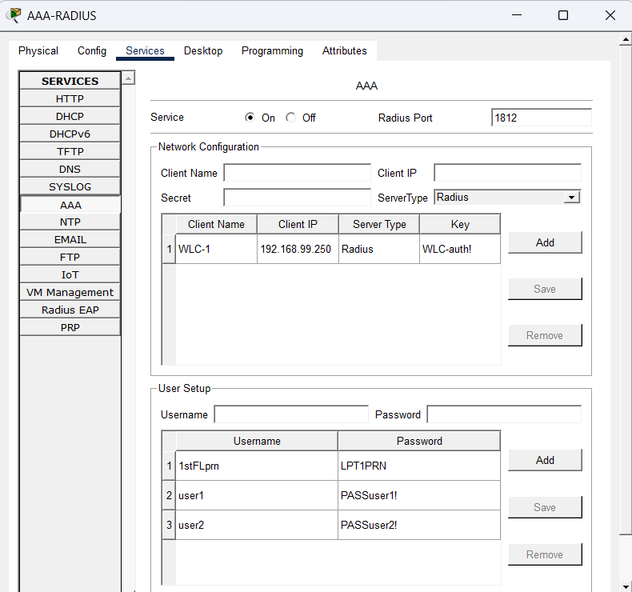
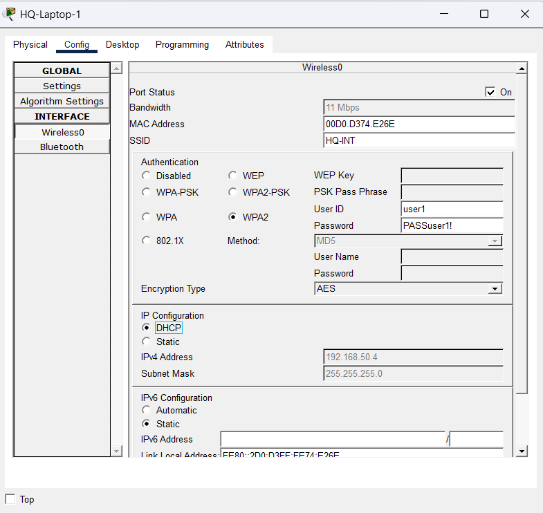
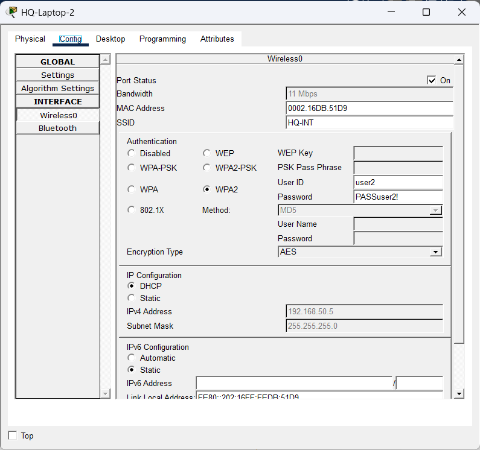
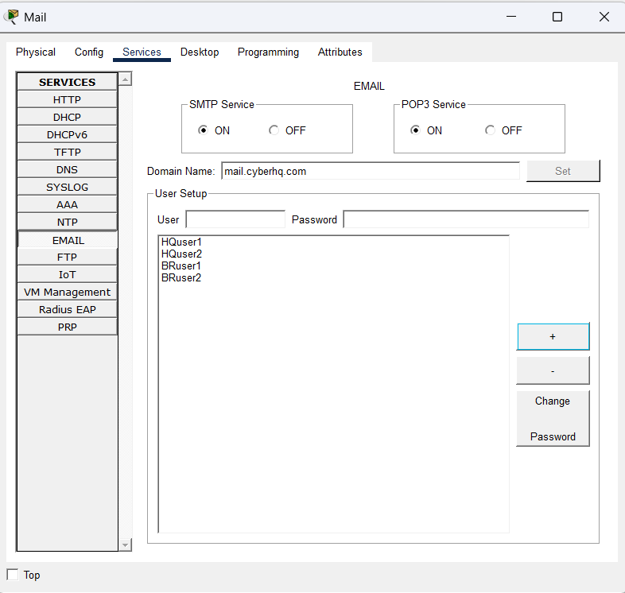
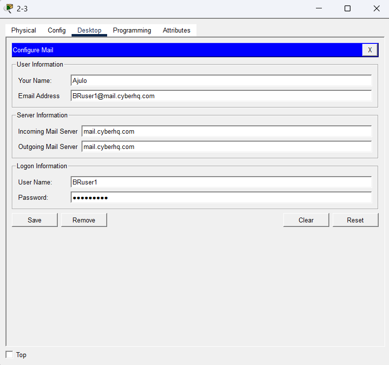
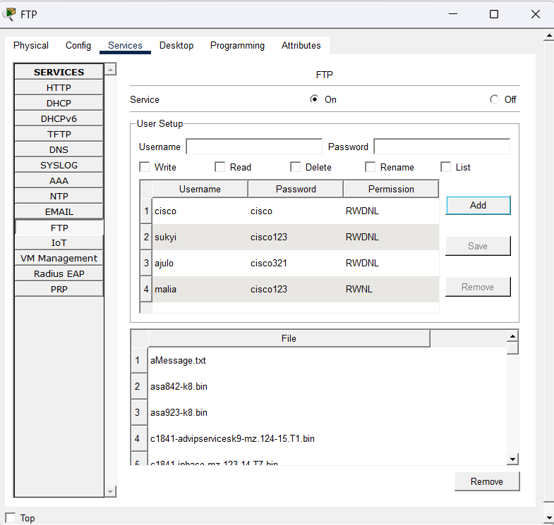
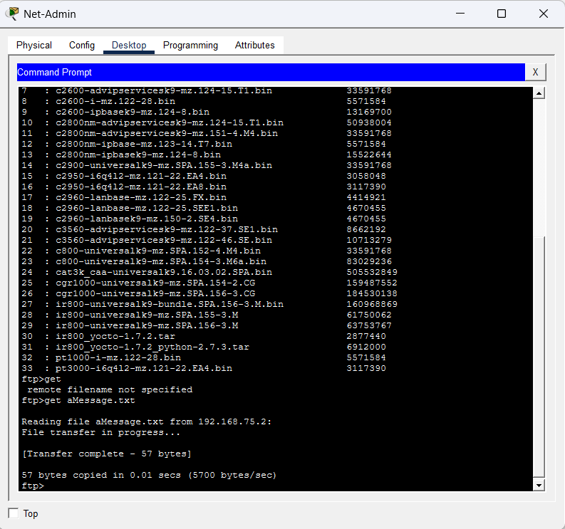
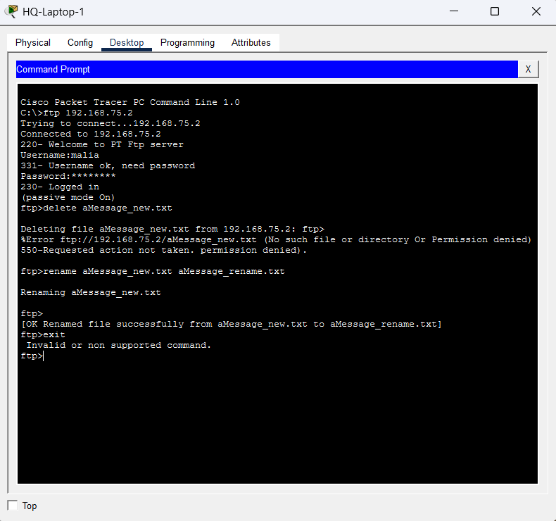
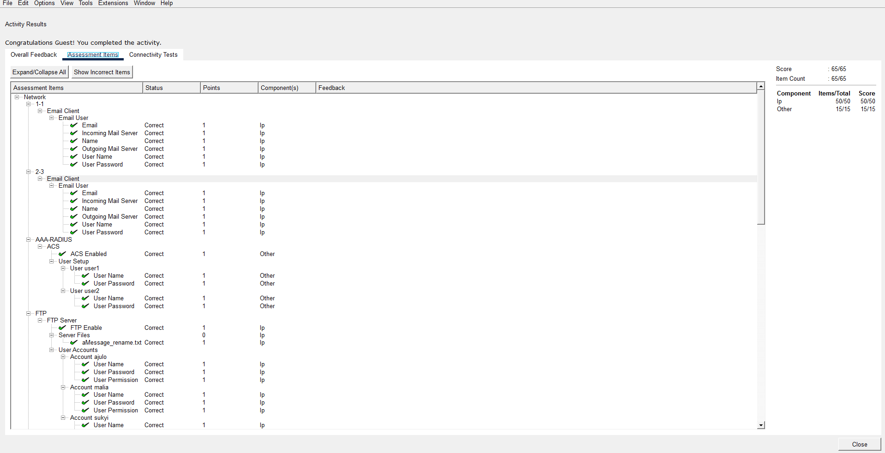

# Packet Tracer: Configure o Controle de Acesso

Lab do curso de Segurança de Endpoint (Cisco Networking Academy). A ideia é configurar autenticação e autorização em serviços de rede: acesso Wi-Fi com AAA/RADIUS, servidor de e-mail e servidor FTP com permissões diferentes por usuário.

**Resultado:** 65/65 no Packet Tracer.

## Autenticação x autorização

- **Autenticação:** confirma quem é o usuário (usuário e senha, por exemplo).
- **Autorização:** define o que esse usuário pode fazer depois que entrou.

O lab mostra os dois na prática. O Wi-Fi e o e-mail cobrem a autenticação, e o FTP mostra bem a autorização, já que cada usuário tem permissões diferentes.

## Parte 1: Autenticação AAA com RADIUS

### Servidor AAA-RADIUS

No servidor AAA-RADIUS (dentro do Wiring Closet), liguei o serviço AAA e criei dois usuários: `user1` e `user2`. O WLC-1 já aparecia como cliente RADIUS na tabela.

### Laptops com WPA2 e usuário/senha

Nos dois laptops do HQ, configurei o SSID `HQ-INT` com WPA2 e criptografia AES, usando as credenciais de cada usuário. O IP veio por DHCP, na rede `192.168.50.0/24`.

| Dispositivo | Usuário | IP recebido |
|---|---|---|
| HQ-Laptop-1 | user1 | 192.168.50.4 |
| HQ-Laptop-2 | user2 | 192.168.50.5 |

## Parte 2: Serviço de e-mail

### Servidor de e-mail

Ativei SMTP e POP3, defini o domínio `mail.cyberhq.com` e criei 4 contas: HQuser1, HQuser2, BRuser1 e BRuser2.

### Clientes de e-mail

Configurei o cliente de e-mail nos PCs (nome, endereço, servidor de entrada e saída, usuário e senha). Abaixo, o PC 2-3 (Ajulo, BRuser1):

### Envio de e-mail

Escrevi um e-mail de teste no PC 1-1 (Suk-Yi) para o BRuser1, mas o envio não completou no Packet Tracer, mesmo com servidor, domínio, contas e clientes configurados corretamente (o próprio verificador do lab marcou tudo como correto). Por isso não tenho o print do Ajulo recebendo a mensagem no PC 2-3.

Essa etapa não é avaliada no lab, e o Packet Tracer às vezes não converge direito nesse tipo de serviço. A configuração de e-mail está validada pelo resultado final (65/65).

## Parte 3: Serviço de FTP

### Servidor FTP e permissões

Ativei o FTP e criei os usuários com permissões diferentes. A diferença principal é que a `malia` **não tem a permissão de Delete**.

| Usuário | Permissões |
|---|---|
| cisco | Read, Write, Delete, Rename, List |
| sukyi | Read, Write, Delete, Rename, List |
| ajulo | Read, Write, Delete, Rename, List |
| malia | Read, Write, Rename, List (sem Delete) |

### Download de arquivo pelo Net-Admin

Entrei no FTP como `sukyi`, listei os arquivos com `dir` e baixei o `aMessage.txt` com `get`. A transferência deu certo (57 bytes).

A mensagem dentro do arquivo era: *"Greetings. You have successfully accessed the FTP server."*

Depois criei o `aMessage_new.txt` e subi pro servidor com `put`.

### Testando as permissões da malia

Entrei no FTP pelo HQ-Laptop-1 como `malia` e testei dois comandos:

- `delete aMessage_new.txt`: **negado** (`550 Requested action not taken. permission denied`).
- `rename aMessage_new.txt aMessage_rename.txt`: **funcionou**.

Ou seja, a malia autentica normalmente (usuário e senha corretos), mas a autorização dela é limitada. Ela consegue renomear, mas não apagar.

## Resultado final

## O que aprendi

- Como habilitar um servidor RADIUS e usar ele pra autenticar usuários no Wi-Fi (WPA2 com usuário e senha individuais, em vez de uma senha única pra todo mundo).
- Como montar um servidor de e-mail básico com SMTP e POP3 e configurar os clientes.
- Como o FTP controla permissões por usuário, e por que dar só o acesso necessário a cada conta (princípio do menor privilégio) faz diferença na segurança.
- A diferença prática entre autenticação e autorização: a malia entra no servidor, mas não pode fazer tudo.

## Observação

As senhas que aparecem nos prints são as do próprio lab, usadas só no Packet Tracer. Em um ambiente real, nunca se deve usar senhas simples assim, nem expor credenciais em prints.
