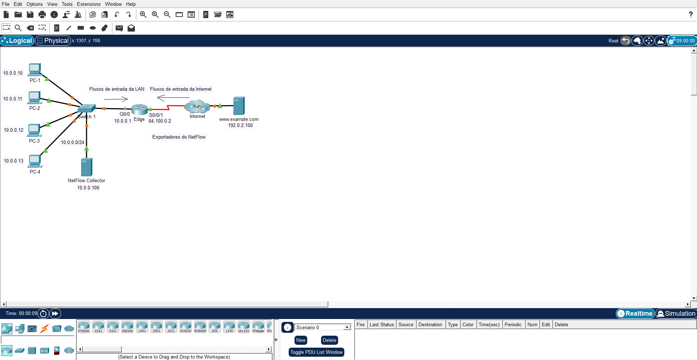
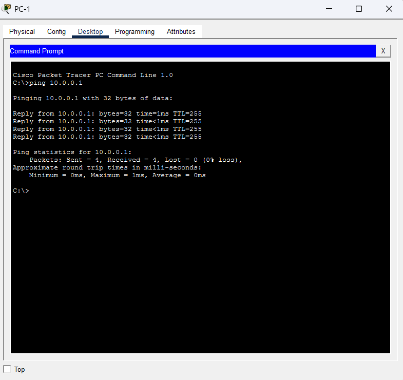
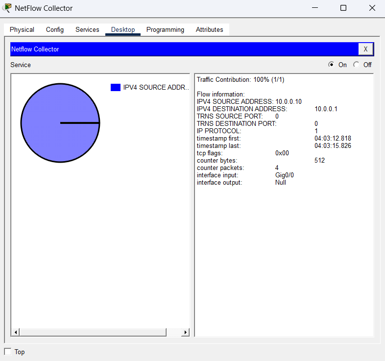
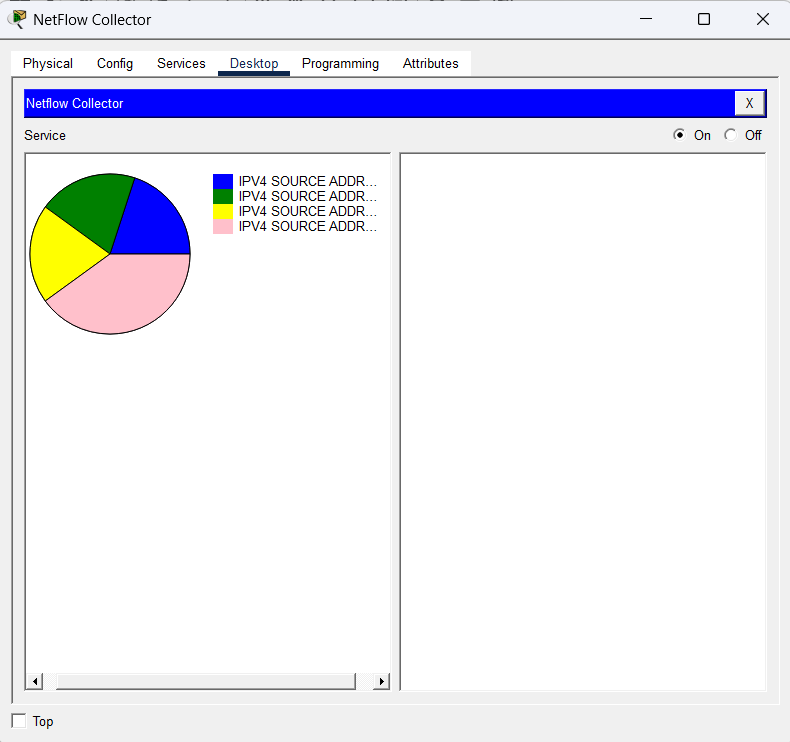
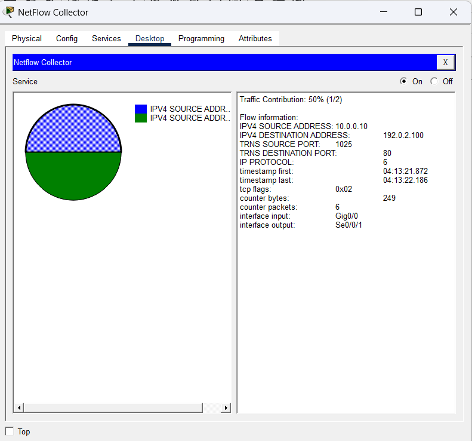
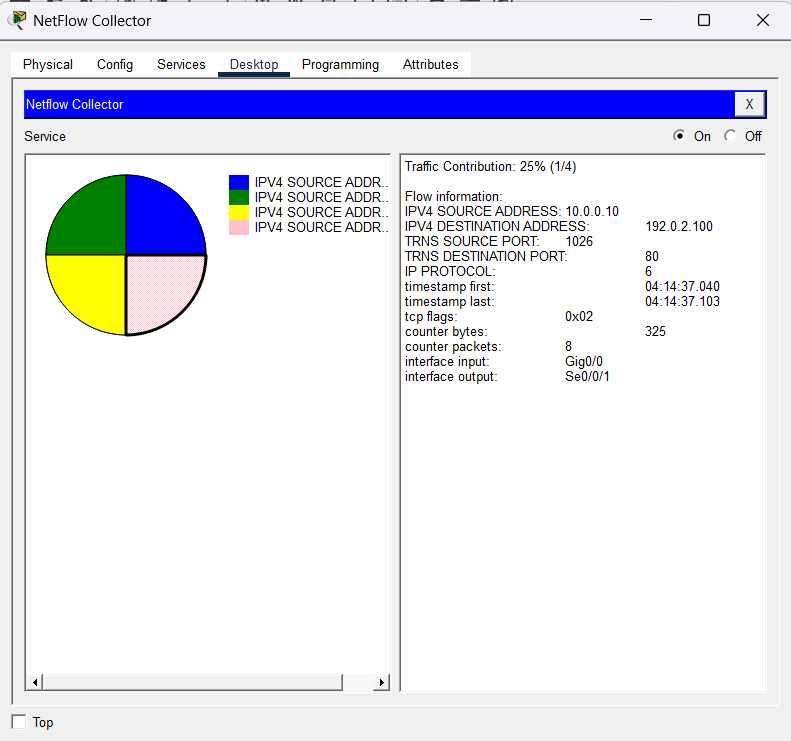
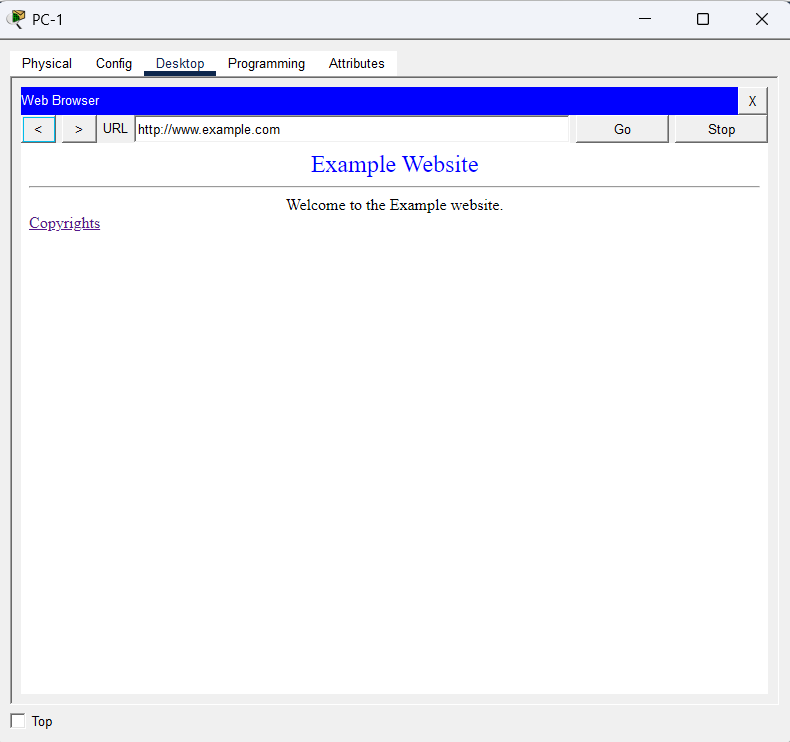

# Packet Tracer: Explorando uma implementação NetFlow

## Objetivos

- Parte 1: Observar registros de fluxo NetFlow em uma direção
- Parte 2: Observar registros NetFlow de uma sessão que entra e sai do coletor

## Como foi feito

A atividade foi concluída em 2 partes. Na primeira, gerei tráfego ICMP (ping) a partir dos PCs da LAN para observar como o coletor NetFlow cria e atualiza os registros de fluxo. Na segunda, gerei tráfego web (HTTP) para um servidor externo, para ver como uma sessão completa aparece em fluxos separados de ida e de volta.

## Topologia

A rede tem 4 PCs (10.0.0.10 a 10.0.0.13) ligados a um switch, o roteador Edge (exportador NetFlow), o coletor NetFlow (10.0.0.100) e o servidor www.example.com (192.0.2.100), acessado pela Internet.

*Imagem 1: Topologia da atividade, com o roteador Edge como exportador NetFlow e o coletor em 10.0.0.100.*

## Parte 1: Registros de fluxo em uma direção

### Ping do PC-1 para o gateway padrão

Com o coletor ligado, executei um ping do PC-1 para o gateway padrão (10.0.0.1).

*Imagem 2: Ping do PC-1 para 10.0.0.1, com 4 pacotes enviados e 4 recebidos.*

O coletor passou a exibir um gráfico de pizza com um único fluxo.

*Imagem 3: Registro de fluxo do ping, com origem 10.0.0.10, destino 10.0.0.1, protocolo 1 (ICMP), 4 pacotes e 512 bytes, entrando pela interface Gig0/0.*

O protocolo 1 é o ICMP, por isso as portas de origem e destino aparecem como 0. Os 4 pacotes do fluxo são os 4 pings enviados.

### Tráfego adicional

Depois do PC-1, fiz pings do PC-2, PC-3 e PC-4 para o mesmo gateway e repeti o ping no PC-1.

- **PC-2, PC-3 e PC-4:** cada um aparece como um novo segmento na pizza, porque o IP de origem é diferente e isso gera um fluxo novo.
- **PC-1 repetido:** não cria um segmento novo. O tráfego entra no fluxo que já existia e os contadores aumentam (de 4 para 8 pacotes).

*Imagem 4: Gráfico de pizza com 4 fluxos. O segmento do PC-1 é maior porque ele enviou o dobro de pacotes.*

## Parte 2: Sessão que entra e sai do coletor

### Acesso ao servidor web por endereço IP

Antes de acessar, desliguei e liguei o coletor para limpar os fluxos antigos. A previsão era de 2 fluxos, um para a requisição que sai da LAN e outro para a resposta que volta da Internet.

- **Requisição:** 10.0.0.10 para 192.0.2.100, protocolo 6 (TCP), porta de origem alta e porta de destino 80, entrando em Gig0/0 e saindo por Se0/0/1.
- **Resposta:** 192.0.2.100 para 10.0.0.10, protocolo 6 (TCP), porta de origem 80 e porta de destino alta, entrando em Se0/0/1.

Acessei `192.0.2.100` no navegador do PC-1 e confirmei a previsão no coletor.

*Imagem 5: Fluxo da requisição HTTP, com origem 10.0.0.10:1025, destino 192.0.2.100:80, protocolo 6, 6 pacotes e 249 bytes.*

Depois cliquei no link da página de copyrights. Apareceram novos segmentos na pizza.

*Imagem 6: Gráfico com 4 fluxos após abrir a página de copyrights. O novo fluxo usa a porta de origem 1026.*

Isso aconteceu porque cada nova conexão TCP usa uma porta de origem diferente (1025 antes, 1026 agora). Como o fluxo é identificado por origem, destino, portas e protocolo, uma porta nova gera fluxos novos.

Comparando requisição e resposta, além de IPs, portas, interfaces e carimbos de tempo, também mudam os contadores de pacotes e bytes e as flags TCP.

### Acesso ao servidor web por URL

Limpei o coletor de novo e acessei `www.example.com` no navegador do PC-1.

*Imagem 7: Página do www.example.com carregada no PC-1 usando a URL.*

Nesse caso, além dos fluxos TCP (protocolo 6, usado pelo HTTP), aparece também um fluxo com protocolo 17 (UDP), que é a consulta DNS para resolver o nome em IP.

## Conclusão

O NetFlow agrupa o tráfego em fluxos definidos por origem, destino, portas e protocolo. Pacotes com os mesmos valores atualizam o fluxo existente, e qualquer diferença cria um fluxo novo. Como o exportador monitora uma direção por interface, uma sessão completa aparece como pelo menos dois fluxos separados.
