# Segurança Física com Dispositivos de IoT (Packet Tracer)

Atividade do Cisco Networking Academy em que configurei dispositivos de IoT de uma casa para melhorar a segurança física, com rede sem fio protegida, filtro de MAC e monitoramento remoto por um servidor de registro.

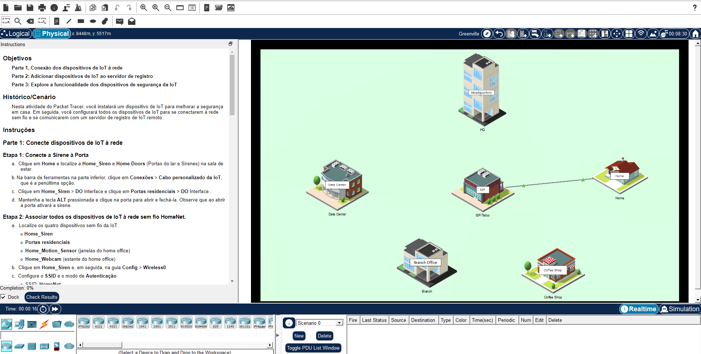
*Imagem 1: Visão geral do cenário no Packet Tracer, com a casa (Home) conectada ao ISP*
## Objetivos

- Conectar os dispositivos de IoT à rede
- Registrar os dispositivos no servidor de registro
- Explorar o funcionamento dos dispositivos de segurança

## Como foi feito
A atividade foi concluída em 3 partes. A ideia foi montar a segurança de uma casa em camadas: primeiros garantir que só dispositivos autorizados entrem na rede, depois centralizar o gerenciamento m um servidor e, por fim, testar se tudo funciona na pratica

- **Parte 1:** conexão dos dispositivos à rede sem fio, com WPA2-PSK e filtro de MAC no roteador
- **Parte 2:** criação de conta e registro dos dispositivos no servidor de registro de IoT
- **Parte 3:** teste dos dispositivos e do monitoramento pelo painel do servidor

## Parte 1: Conectando os dispositivos à rede

### Sirene e porta

Liguei a sirene (Home_Siren) na porta (Home Doors) usando o cabo personalizado de IoT, pela interface DO de cada um. Com isso, abrir a porta (ALT + clique) dispara a sirene.

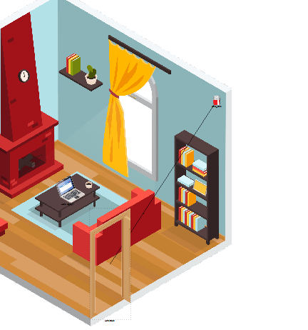
*Imagem 2: Sirene conectada à porta pelo cabo personalizado de IoT*

### Rede sem fio HomeNet

Nos quatro dispositivos (Home_Siren, Home Doors, Home_Motion_Sensor e Home_Webcam), configurei:

- SSID: `HomeNet`
- Autenticação: WPA2-PSK
- Criptografia: AES
- IP: DHCP (rede 192.168.0.0/24)

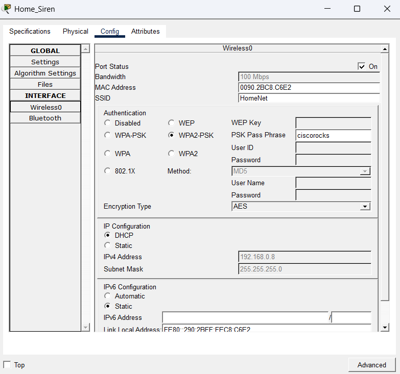
*Imagem 3: Configuração da rede sem fio no Home_Siren (SSID HomeNet, WPA2-PSK,AES e DHCP)*
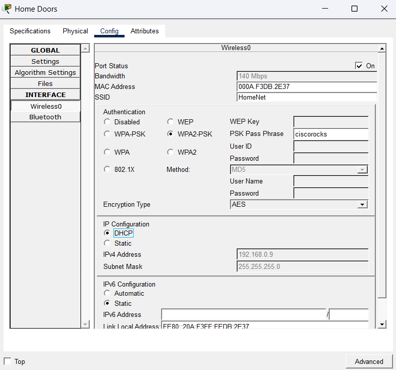
*Imagem 4: Configuração da rede sem fio no Home Doors*
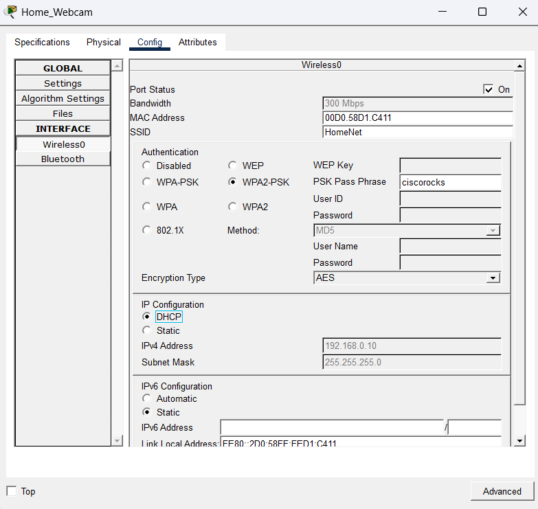
*Imagem 5: Configuração da rede sem fio na Home_Webcam*
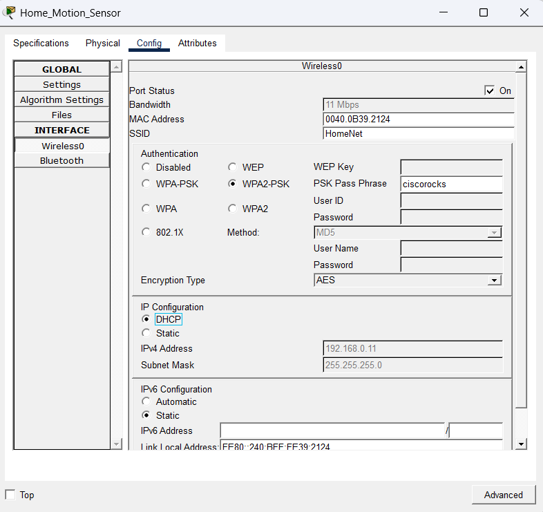
*Imagem 6:Configuração da rede sem fio no Home_Motion_Sensor*

### Endereços MAC

O Packet Tracer mostra o MAC no formato Cisco (com pontos). Para o filtro do roteador, converti para o formato com dois pontos:

| Dispositivo | MAC (Cisco) | MAC (filtro) | IP recebido |
|---|---|---|---|
| Home_Siren | 0090.2BC8.C6E2 | 00:90:2B:C8:C6:E2 | 192.168.0.8 |
| Home Doors | 000A.F3DB.2E37 | 00:0A:F3:DB:2E:37 | 192.168.0.9 |
| Home_Webcam | 00D0.58D1.C411 | 00:D0:58:D1:C4:11 | 192.168.0.10 |
| Home_Motion_Sensor | 0040.0B39.2124 | 00:40:0B:39:21:24 | 192.168.0.11 |

Obs: o campo de MAC do próprio dispositivo só aceita o formato Cisco. O formato com dois pontos serve só para o filtro do roteador (digitar com dois pontos no dispositivo dá "Invalid MAC address entered").

### Filtro de MAC no roteador

Acessei o roteador pelo navegador do Home Office PC (`192.168.0.1`), fui em Wireless > Wireless MAC Filter e deixei:

- Filtro habilitado na porta 2.4G
- Opção "Permit PCs listed below to access wireless network"
- Os quatro MACs dos dispositivos adicionados na tabela

Só quem está na lista consegue entrar na rede, mesmo sabendo a senha do Wi-Fi.

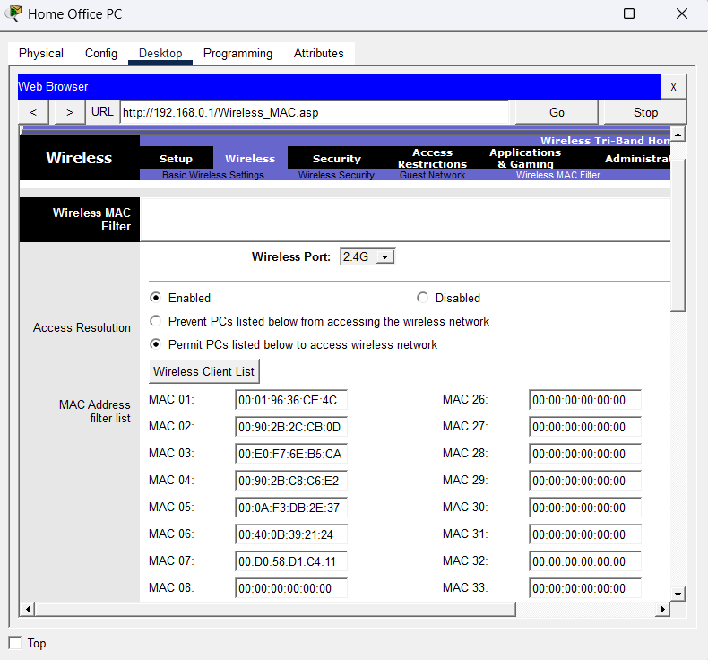
*Imagem 7: Wireless MAC Filter habilitado no roteador, com os MACs dos dispositivos na lista*

## Parte 2: Servidor de registro

Criei uma conta no servidor de registro (`10.3.0.125`) e registrei cada dispositivo em Config > Settings > IoT Server, selecionando **Remote Server** com o endereço do servidor e o usuário `HomeUser`.

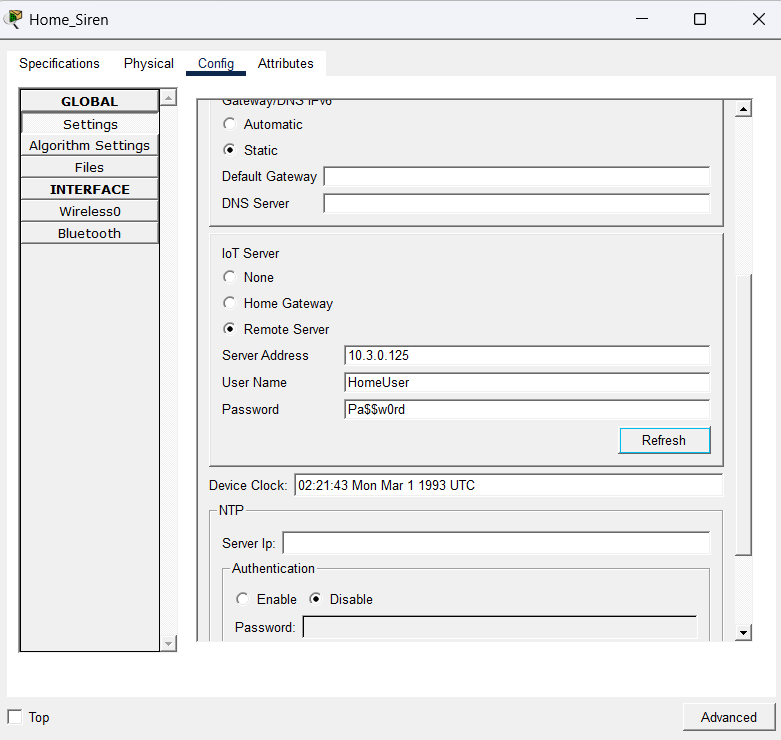
*Imagem 8: Registro do Home_Siren no servidor remoto de IoT*
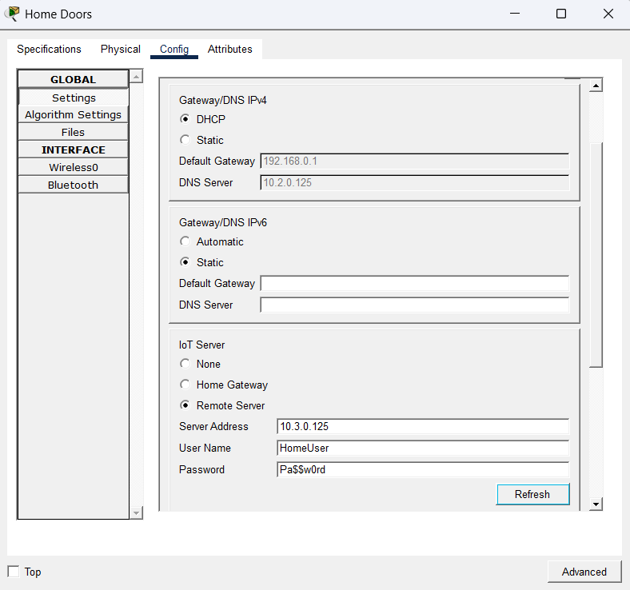
*Imagem 9: Registro do Home Doors no servidor remoto de IoT*
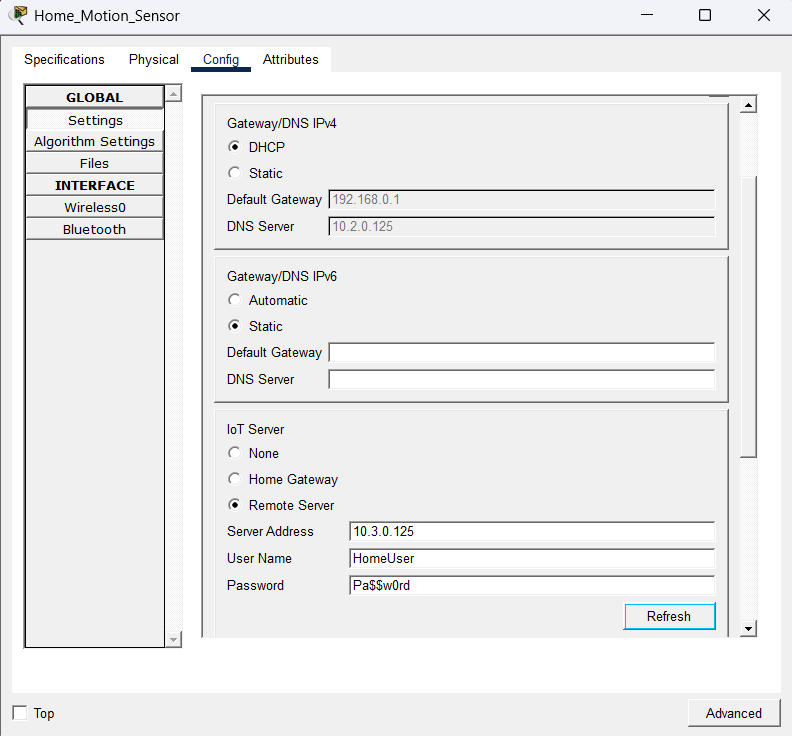
*Imagem 10: Registro do Home_Motion_Sensor no servidor remoto de IoT*

*Imagem 11: Registro da Home_Webcam no servidorremoto de IoT*

Depois, fiz login no servidor pelo navegador do Home Office PC e confirmei que os quatro dispositivos apareceram registrados.

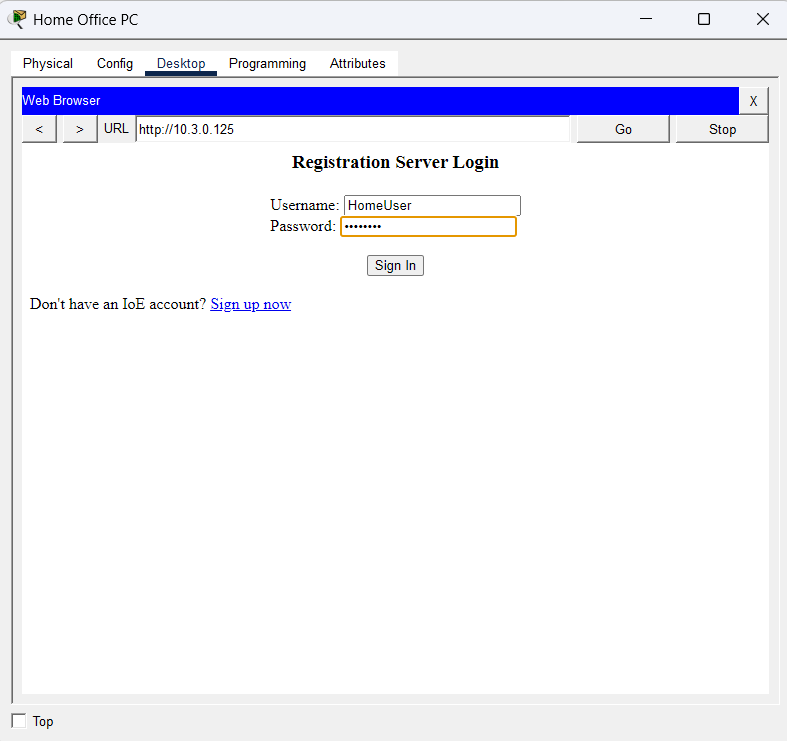
*Imagem 12: Tela de login do servidor de registro*
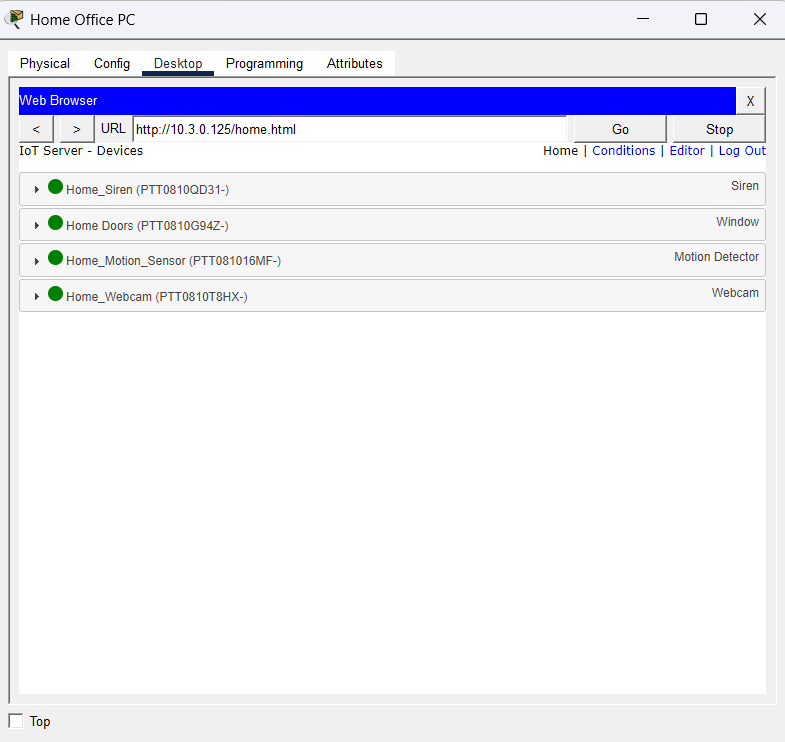
*Imagem 13: Os quatro dispositivos registrados no servidor*

## Parte 3: Testando os dispositivos

No painel do servidor dá para ver o status de cada dispositivo e controlar alguns deles:

- A porta e a webcam podem ser ligadas e desligadas pelo painel
- O sensor de movimento só envia informação para o servidor, então só dá para monitorar
- Ao mover o mouse sobre o sensor (ALT), ele detecta movimento e a webcam mostra a imagem de alguém passando

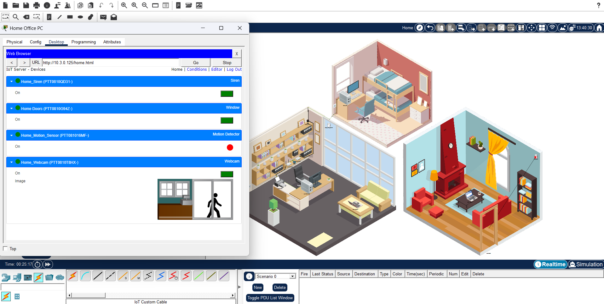
*Imagem 14: Painel do servidor com os dispositivos abertos e a webcam mostrando uma pessoa passando*

## Resultado

Atividade concluída com 12/12 nos itens de avaliação.

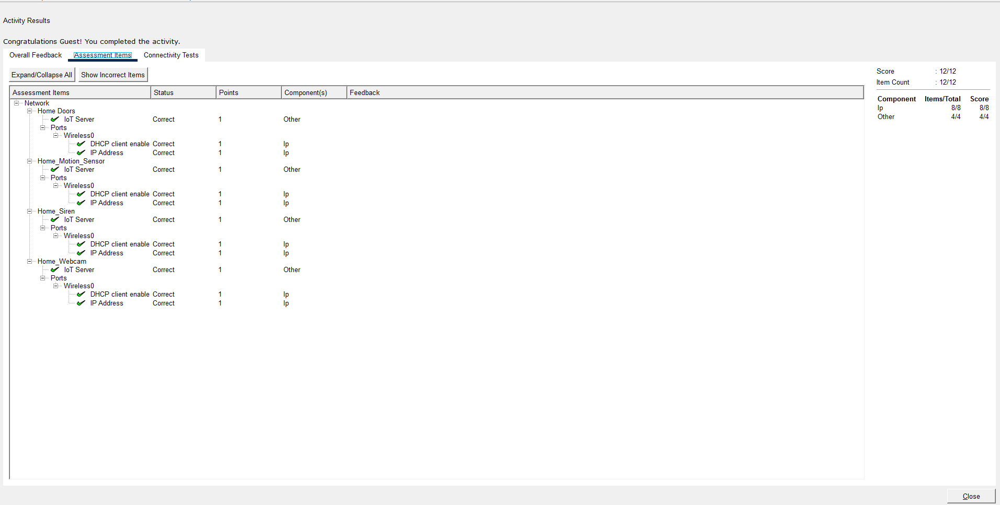
*Imagem 15: resultado da atividade com pontuação 12/12*

## O que aprendi

- IoT ajuda na segurança de casa porque dá para monitorar e controlar tudo remotamente, em tempo real
- Um servidor de registro centraliza o gerenciamento dos dispositivos em um lugar só
- WPA2-PSK com AES protege a conexão, e o filtro de MAC adiciona uma camada extra de controle de acesso
- Filtro de MAC sozinho não é segurança forte (MAC pode ser clonado), então funciona melhor junto com outras camadas
